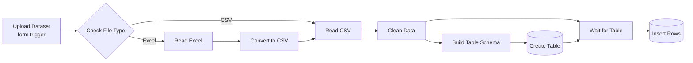

# Dataset Upload → PostgreSQL (n8n)

An n8n workflow that turns a messy CSV or Excel file into a clean PostgreSQL table. You drop the file into a web form. n8n checks whether it's Excel or CSV, cleans the data, works out a column type for each field, creates the table if it doesn't exist yet, and inserts every row.

No SQL to write, no `COPY` commands, no fixing headers by hand first.


## The problem

Hand-typed spreadsheets are rarely ready for a database. Amounts look like `Tk 1,250`, half the cells say `N/A`, dates come in three formats, and there's always a blank row somewhere in the middle. Loading that into Postgres usually means a round of cleanup in Excel before a single query runs. This workflow does the cleanup the same way every time.

## How it works



| # | Node | What it does |
|---|------|--------------|
| 1 | **Upload Dataset** (Form Trigger) | Web form at `/form/upload-dataset`. Takes one file (`.csv`, `.xlsx`, `.xls`) and an optional table name. It replies right away with "Got it. Your dataset is being loaded into PostgreSQL." so the user isn't left staring at a spinner. |
| 2 | **Check File Type** (Switch) | Looks at the file extension and MIME type. `.xlsx` / `.xls` or a spreadsheet MIME type goes to output 1 (Excel). Everything else goes to output 0 (CSV). |
| 3 | **Read Excel** (Extract From File) | Reads the first sheet with the header row, keeping empty cells so columns don't shift. |
| 4 | **Convert to CSV** (Convert to File) | Turns the Excel rows into a CSV, so both paths join at the same place and get cleaned by the same code. |
| 5 | **Read CSV** (Extract From File) | Parses the CSV (BOM-aware, header row, empty cells kept). |
| 6 | **Clean Data** (Code) | The cleaning rules, listed below. |
| 7 | **Build Table Schema** (Code) | Picks the table name, guesses a type per column and builds the `CREATE TABLE IF NOT EXISTS` statement. |
| 8 | **Create Table** (Postgres) | Runs that statement. |
| 9 | **Wait for Table** (Merge, choose branch) | Holds the cleaned rows until the table exists, then passes them on. Without it, the insert could run before the `CREATE TABLE` finishes. |
| 10 | **Insert Rows** (Postgres) | Inserts all rows into `public.<table>` in a single query, with columns auto-mapped. The native Postgres node does the heavy lifting here, so big files don't overload the Code node runner. |

### Cleaning rules (Clean Data node)

1. **Text** – trims spaces, removes non-breaking spaces and zero-width characters, and squeezes repeated whitespace down to one.
2. **Nulls** – `''`, `NA`, `N/A`, `#N/A`, `null`, `none`, `nil`, `NaN`, `-`, `--`, `?`, `#VALUE!`, `#DIV/0!` and `#REF!` all become a real SQL `NULL`.
3. **Numbers** – strips thousands separators and currency (`৳`, `Tk`, `BDT`, `$`, `€`, `£`). Accounting-style negatives like `(300)` become `-300`.
4. **Headers** – converted to SQL-safe `snake_case`. Blank headers get a `column_N` name, duplicate headers get `_2`, `_3`, and a name starting with a digit gets a `t_` prefix.
5. **Rows** – drops rows that are completely empty and rows that are exact duplicates.
6. **Columns** – drops columns that are empty in every row.
7. **Dates** – a column is converted to `YYYY-MM-DD` only if *every* value in it parses as a valid date. Supported shapes: `2026-03-18`, `15/01/2026`, `05.03.26`, `3-Feb-2026`, `Feb 3, 2026`. For ambiguous `xx/xx/yyyy` values, a day above 12 settles the order. If nothing settles it, CSV files are read as day-first and Excel files as month-first, because that's how Excel displays dates by default.

### Type detection (Build Table Schema node)

Each column gets the narrowest type that fits every non-empty value:

`BIGINT` → `NUMERIC` → `DATE` → `TEXT`

A value with a leading zero (`01712345678`, `00123`) forces the column to `TEXT`, so phone numbers and codes keep their zeros. Every table also gets a `loaded_at TIMESTAMP DEFAULT now()` column so you can tell batches apart.

The table name is whatever you type in the form. Leave it blank and the file name is used instead (`Sales Report 2026.xlsx` → `sales_report_2026`).

## Example

`sample-data/messy_sales.csv` – 7 rows, 9 columns, the usual mess:

| Order ID | Order Date | Customer Name | Region | Amount (Tk) | Qty | Phone | Remarks | |
|---|---|---|---|---|---|---|---|---|
| 1001 | 15/01/2026 | `  Rahim Uddin ` | Dhaka | Tk 1,250 | 2 | 01712345678 | | |
| 1002 | 3-Feb-2026 | Karim Traders | Chattogram | BDT 12,400.50 | 10 | 01898765432 | N/A | |
| 1003 | 28/02/2026 | Nasrin Akter | Sylhet | (300) | 1 | 01555123456 | | |
| 1004 | 05/03/2026 | Hossain & Sons | Dhaka | ৳ 2,000 | NA | 01911222333 | - | |
| 1002 | 3-Feb-2026 | Karim Traders | Chattogram | BDT 12,400.50 | 10 | 01898765432 | N/A | |
| | | | | | | | | |
| 1005 | 2026-03-18 | Mitu Store | khulna | 950 | 3 | 01633444555 | null | |

What lands in Postgres – 5 rows, 7 columns (+ `loaded_at`):

```sql
CREATE TABLE IF NOT EXISTS public."messy_sales" (
  "order_id" BIGINT, "order_date" DATE, "customer_name" TEXT, "region" TEXT,
  "amount_tk" NUMERIC, "qty" BIGINT, "phone" TEXT,
  loaded_at TIMESTAMP DEFAULT now()
);
```

```
 order_id | order_date | customer_name  |   region   | amount_tk | qty |    phone
----------+------------+----------------+------------+-----------+-----+-------------
     1001 | 2026-01-15 | Rahim Uddin    | Dhaka      |      1250 |   2 | 01712345678
     1002 | 2026-02-03 | Karim Traders  | Chattogram |  12400.50 |  10 | 01898765432
     1003 | 2026-02-28 | Nasrin Akter   | Sylhet     |      -300 |   1 | 01555123456
     1004 | 2026-03-05 | Hossain & Sons | Dhaka      |      2000 |     | 01911222333
     1005 | 2026-03-18 | Mitu Store     | khulna     |       950 |   3 | 01633444555
```

The duplicate order and the blank row are gone. `Remarks` was empty or junk in every row, so it was dropped along with the unnamed last column. Mixed date formats became one. The phone numbers kept their leading zero.

`sample-data/messy_sales.xlsx` has the same kind of mess in an Excel file (real date cells, a duplicate, a blank row) for testing the Excel branch.

## Setup

**You need:** n8n (self-hosted) and a PostgreSQL database you can write to.

1. **Import the workflow.** In n8n go to *Workflows → Import from File* and pick [`workflow/dataset-upload-to-postgres.json`](workflow/dataset-upload-to-postgres.json).
2. **Add a Postgres credential.** Host, port (`5432`), database, user and password. Select it on both the **Create Table** and **Insert Rows** nodes.
   If n8n runs in Docker and Postgres runs on your machine, use `host.docker.internal` as the host instead of `localhost`.
3. **Test it.** Open the **Upload Dataset** node, click *Test step* and use the test form URL (`/form-test/upload-dataset`).
4. **Publish it.** Once it's active, the form lives at `http://localhost:5678/form/upload-dataset`. Anyone with the link can load data, no n8n login needed.
5. **Check the result:**

   ```sql
   SELECT * FROM public.messy_sales ORDER BY loaded_at DESC LIMIT 20;
   ```

## Things to know

- Uploading the same file twice appends the rows again. There's no upsert. The `loaded_at` column makes it easy to find and delete a batch.
- `CREATE TABLE IF NOT EXISTS` won't change a table that already exists. If you load a file with new or renamed columns into an existing table name, the insert fails, so give it a new name or drop the old table first.
- Only the first sheet of an Excel workbook is read.
- The whole file is processed in memory, so very large files (hundreds of MB) are better loaded with `COPY`.

## Repo structure

```
├── workflow/
│   └── dataset-upload-to-postgres.json   # import this into n8n
├── screenshots/
│   ├── workflow.png                      # the canvas
│   └── upload-form.png                   # the upload form
├── sample-data/
│   ├── messy_sales.csv                   # test file for the CSV path
│   └── messy_sales.xlsx                  # test file for the Excel path
└── README.md
```


## Built with

n8n · PostgreSQL · JavaScript (Code nodes)

---

Built by [Md Ismam Tasnime](https://github.com/ismam-tasnime)
