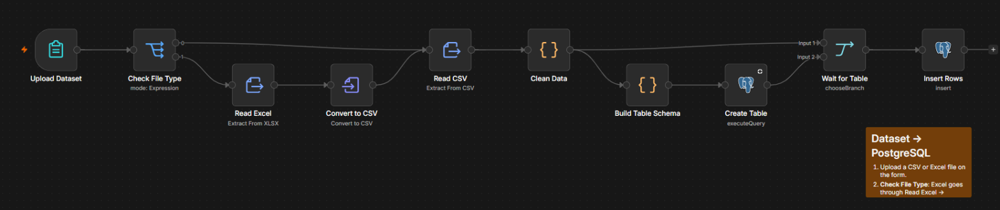
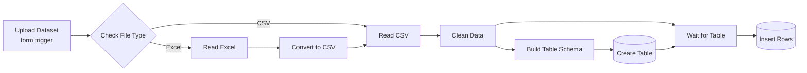
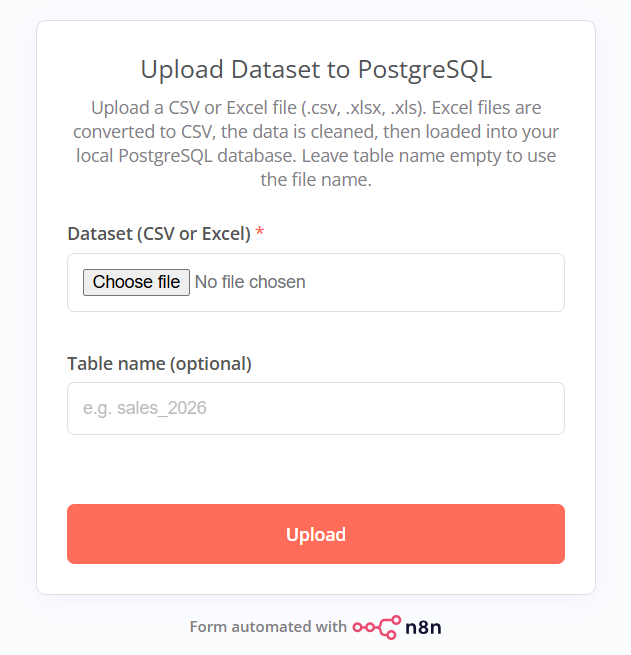

# Dataset Upload → PostgreSQL (n8n)

This n8n workflow takes a messy CSV or Excel file from a web form and loads it into PostgreSQL as a clean table. It checks whether the file is Excel or CSV, cleans the data, picks a column type for each field, creates the table if it isn't there yet, and inserts every row. You don't need to write SQL or tidy the headers first.



## The problem

Spreadsheets typed by hand are rarely ready for a database. Amounts look like `Tk 1,250`, half the cells say `N/A`, dates come in three formats, and a blank row usually turns up somewhere in the middle. Getting that into Postgres normally means a round of cleanup in Excel before you can run a single query. This workflow applies the same cleanup to every file.

## How it works



| # | Node | What it does |
|---|------|--------------|
| 1 | Upload Dataset (Form Trigger) | A web form at `/form/upload-dataset` that accepts one file (`.csv`, `.xlsx`, `.xls`) and an optional table name. It answers straight away with "Got it. Your dataset is being loaded into PostgreSQL." so whoever uploaded the file isn't stuck waiting on the page. |
| 2 | Check File Type (Switch) | Reads the file extension and MIME type. `.xlsx`, `.xls` or a spreadsheet MIME type goes to output 1 (Excel), and everything else goes to output 0 (CSV). |
| 3 | Read Excel (Extract From File) | Reads the first sheet with its header row and keeps empty cells so the columns stay lined up. |
| 4 | Convert to CSV (Convert to File) | Writes the Excel rows out as a CSV. Both paths meet at Read CSV after this and go through the same cleaning code. |
| 5 | Read CSV (Extract From File) | Parses the CSV. It handles a BOM at the start of the file, uses the first row as headers and keeps empty cells. |
| 6 | Clean Data (Code) | Applies the cleaning rules listed below. |
| 7 | Build Table Schema (Code) | Chooses the table name, guesses a type for each column and writes the `CREATE TABLE IF NOT EXISTS` statement. |
| 8 | Create Table (Postgres) | Runs that statement. |
| 9 | Wait for Table (Merge, choose branch) | Holds the cleaned rows until the table exists, then passes them on. Without this step the insert could start before `CREATE TABLE` has finished. |
| 10 | Insert Rows (Postgres) | Inserts every row into `public.<table>` in one query and maps the columns automatically. The insert runs in the Postgres node instead of a Code node, so large files don't overload the Code node runner. |

### Cleaning rules (Clean Data node)

1. Text is trimmed. Non-breaking spaces and zero-width characters are removed, and runs of whitespace collapse to a single space.
2. `''`, `NA`, `N/A`, `#N/A`, `null`, `none`, `nil`, `NaN`, `-`, `--`, `?`, `#VALUE!`, `#DIV/0!` and `#REF!` all become a real SQL `NULL`.
3. Numbers lose their thousands separators and currency markers (`৳`, `Tk`, `BDT`, `$`, `€`, `£`). Accounting negatives like `(300)` become `-300`.
4. Headers are converted to SQL-safe `snake_case`. A blank header becomes `column_N`, repeated headers get `_2`, `_3` and so on, and a name that starts with a digit gets a `t_` prefix.
5. Rows that are completely empty are dropped, and so are exact duplicates.
6. A column with no value in any row is dropped.
7. A column is converted to `YYYY-MM-DD` only when *every* value in it parses as a valid date. The parser understands `2026-03-18`, `15/01/2026`, `05.03.26`, `3-Feb-2026` and `Feb 3, 2026`. With ambiguous `xx/xx/yyyy` values, any day above 12 decides which number is the day. When nothing decides it, CSV files are read day first and Excel files month first, because Excel shows dates month first by default.

### Type detection (Build Table Schema node)

Each column gets the first type that fits all of its non-empty values, checked in the order `BIGINT`, `NUMERIC`, `DATE`, `TEXT`. A single value with a leading zero (`01712345678`, `00123`) makes the whole column `TEXT`, which keeps phone numbers and codes intact. Every table also gets a `loaded_at TIMESTAMP DEFAULT now()` column so you can tell one batch from another.

The table name comes from the form. Leave it blank and the file name is used instead, so `Sales Report 2026.xlsx` becomes `sales_report_2026`.

## Example

`sample-data/messy_sales.csv` has 7 rows and 9 columns:

| Order ID | Order Date | Customer Name | Region | Amount (Tk) | Qty | Phone | Remarks | |
|---|---|---|---|---|---|---|---|---|
| 1001 | 15/01/2026 | `  Rahim Uddin ` | Dhaka | Tk 1,250 | 2 | 01712345678 | | |
| 1002 | 3-Feb-2026 | Karim Traders | Chattogram | BDT 12,400.50 | 10 | 01898765432 | N/A | |
| 1003 | 28/02/2026 | Nasrin Akter | Sylhet | (300) | 1 | 01555123456 | | |
| 1004 | 05/03/2026 | Hossain & Sons | Dhaka | ৳ 2,000 | NA | 01911222333 | - | |
| 1002 | 3-Feb-2026 | Karim Traders | Chattogram | BDT 12,400.50 | 10 | 01898765432 | N/A | |
| | | | | | | | | |
| 1005 | 2026-03-18 | Mitu Store | khulna | 950 | 3 | 01633444555 | null | |

After cleaning, 5 rows and 7 columns reach Postgres, plus `loaded_at`:

```sql
CREATE TABLE IF NOT EXISTS public."messy_sales" (
  "order_id" BIGINT, "order_date" DATE, "customer_name" TEXT, "region" TEXT,
  "amount_tk" NUMERIC, "qty" BIGINT, "phone" TEXT,
  loaded_at TIMESTAMP DEFAULT now()
);
```

```
 order_id | order_date | customer_name  |   region   | amount_tk | qty |    phone
----------+------------+----------------+------------+-----------+-----+-------------
     1001 | 2026-01-15 | Rahim Uddin    | Dhaka      |      1250 |   2 | 01712345678
     1002 | 2026-02-03 | Karim Traders  | Chattogram |  12400.50 |  10 | 01898765432
     1003 | 2026-02-28 | Nasrin Akter   | Sylhet     |      -300 |   1 | 01555123456
     1004 | 2026-03-05 | Hossain & Sons | Dhaka      |      2000 |     | 01911222333
     1005 | 2026-03-18 | Mitu Store     | khulna     |       950 |   3 | 01633444555
```

The second copy of order 1002 and the blank row are gone. `Remarks` held nothing but blanks, `N/A`, `-` and `null`, so it was dropped along with the unnamed last column. The dates arrived in three formats and now share one, and the phone numbers still start with 0.

`sample-data/messy_sales.xlsx` is an Excel file with the same kind of problems (real date cells, a duplicate row and a blank row) for testing the Excel branch.

## Setup

You need a self-hosted n8n instance and a PostgreSQL database you can write to.

1. In n8n, open *Workflows → Import from File* and choose [`workflow/dataset-upload-to-postgres.json`](workflow/dataset-upload-to-postgres.json).
2. Create a Postgres credential with the host, port (`5432`), database, user and password, then select it on both the Create Table and Insert Rows nodes. If n8n runs in Docker and Postgres runs on your machine, use `host.docker.internal` as the host instead of `localhost`.
3. Open the Upload Dataset node, click *Test step* and try a file through the test form URL (`/form-test/upload-dataset`).
4. Publish the workflow. The live form is at `http://localhost:5678/form/upload-dataset`. It has no login, so anyone with the link can load data into your database.

   

5. Check what landed:

   ```sql
   SELECT * FROM public.messy_sales ORDER BY loaded_at DESC LIMIT 20;
   ```

## Things to know

- Uploading the same file twice appends the rows a second time, since there's no upsert. The `loaded_at` column makes it easy to find a batch and delete it.
- `CREATE TABLE IF NOT EXISTS` leaves an existing table as it is. If you load a file with new or renamed columns into a table name that already exists, the insert fails, so pick a new name or drop the old table first.
- Only the first sheet of an Excel workbook is read.
- The whole file is processed in memory. For very large files (hundreds of MB), `COPY` is the better tool.

## Repo structure

```
├── workflow/
│   └── dataset-upload-to-postgres.json   # import this into n8n
├── screenshots/
│   ├── workflow.png                      # the canvas
│   └── upload-form.png                   # the upload form
├── sample-data/
│   ├── messy_sales.csv                   # test file for the CSV path
│   └── messy_sales.xlsx                  # test file for the Excel path
└── README.md
```

Built by [Md Ismam Tasnime](https://github.com/ismam-tasnime) with n8n, PostgreSQL and JavaScript Code nodes.
